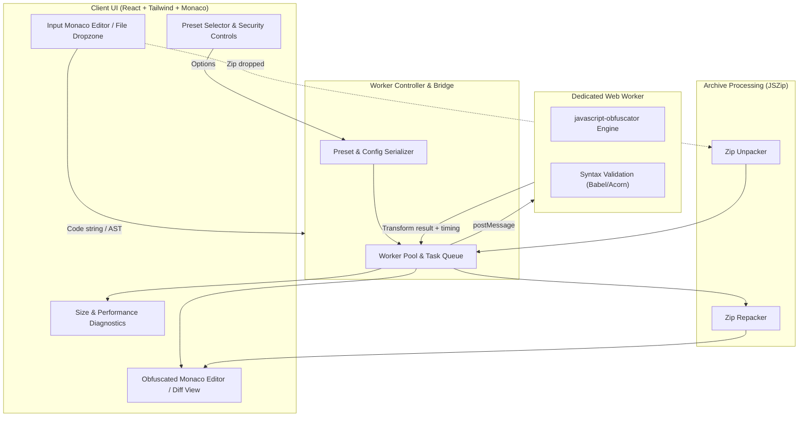

# Design Specification: Web-Based JavaScript Obfuscation Service

**Date:** 2026-11-06  
**Status:** Approved by Human Partner  
**Target:** In-Browser Developer Utility & Multi-File Obfuscation Platform  

---

## 1. Executive Summary & Intent

Modern web developers, script authors, and software vendors frequently need to protect client-side JavaScript from reverse-engineering, casual scraping, and tampering. However, most available web obfuscators either pass sensitive code through untrusted third-party servers, freeze the browser tab on larger scripts, expose an overwhelming wall of cryptic configuration knobs, or lack batch processing for multi-file bundles.

This project delivers a **fast, privacy-first, zero-trust web application** that performs client-side JavaScript obfuscation using Web Workers. It provides an intuitive Monaco-powered interactive playground for single scripts alongside batch `.zip` archive processing for entire projects, complete with curated outcome presets, real-time performance/size metrics, anti-tamper security controls, and configuration export utilities.

---

## 2. Goals, Non-Goals & Anti-Goals

### 2.1 Goals
- **Zero-Trust Privacy**: 100% in-browser transformation; no proprietary code touches any remote server.
- **Responsive Main Thread**: Offload heavy AST transformations to dedicated Web Workers with cancellation and timeout safety.
- **Tiered Ergonomics**: Curated presets (*Light / Performance*, *Balanced*, *Stealth / High Security*) alongside an advanced configuration drawer.
- **Multi-File & Archive Support**: Drag-and-drop batch processing of single files or `.zip` archives with full file preservation.
- **Diagnostic Transparency**: Real-time metrics on file size delta, percentage bloat, execution duration, and syntax verification.
- **Production Readiness Utilities**: Built-in support for domain locking, self-defending anti-tampering, CLI script generation, and JSON configuration export/import.

### 2.2 Non-Goals (V1)
- Building a custom AST parsing and transformation engine from scratch (we wrap and customize standard `javascript-obfuscator`).
- Cloud account management, multi-tenant databases, or subscription billing infrastructure.
- Complete irreversible obfuscation of server-side Node.js compiled binaries (this tool targets standard JavaScript / TypeScript source bundles).

### 2.3 Anti-Goals
- Blocking the main UI thread during AST traversal.
- Silently altering or corrupting valid JavaScript syntax without warnings.
- Requiring an active internet connection after initial asset loading.

---

## 3. Evaluated Approaches & Tradeoffs

| Approach | Description | Pros | Cons / Tradeoffs | Decision |
| :--- | :--- | :--- | :--- | :--- |
| **A. Remote Backend Service (Node.js / Cloudflare Workers)** | User code is posted via REST API to a cluster of backend workers running the obfuscator. | Centralized rate-limiting, ability to hide proprietary obfuscation logic, smaller initial client bundle. | Severe privacy concerns (untrusted server sees plain IP), server hosting & compute costs, latency on large bundles. | **Rejected** |
| **B. Client-Side Main Thread Execution** | Bundled `javascript-obfuscator` runs directly in React component lifecycle. | Simple to write, no worker message passing. | Obfuscation easily locks the browser UI for 2-10+ seconds, causing "Page Unresponsive" browser warnings. | **Rejected** |
| **C. In-Browser Web Worker Engine (Chosen)** | Transformations run in a dedicated Web Worker via `@monaco-editor/react` & `javascript-obfuscator`, wrapped with termination fallbacks. | Completely private, zero server cost, zero lag on UI/typing, offline-capable PWA ready, scalable to multi-file queues. | Requires handling worker lifecycle, serialization of config objects, and bundle size management for worker scripts. | **Accepted** |

---

## 4. Architecture & Technical Stack



### 4.1 Tech Stack
- **Framework & Bundler:** React 18/19 + TypeScript + Vite.
- **Styling & UI:** Tailwind CSS, Lucide React (icons), Radix UI / custom accessible toggles.
- **Code Editor:** `@monaco-editor/react` (configured for JS/TS with syntax highlighting, auto-formatting, and diff mode).
- **Core Obfuscation Engine:** `javascript-obfuscator` (executed in Web Worker).
- **Archive & File Utilities:** `jszip` and `file-saver` for batch packaging.
- **Syntax Diagnostics:** Lightweight Babel parser (`@babel/parser`) or Acorn inside the worker for pre/post structural checks.

---

## 5. Feature Specifications

### 5.1 Dual-Pane Interactive Playground
- **Left Pane:** Input code editor (line numbers, folding, sample code presets: Basic Script, Async API Fetcher, React Component snippet).
- **Right Pane:** Output code editor (read-only, instant copy button, download button, and a toggle for "Side-by-side Diff" view).
- **Control Bar:**
  - One-click **Obfuscate** button with live progress indicator.
  - Cancel button to abort running worker operations immediately.
  - Automatic re-obfuscate toggle (debounced at 600ms, disabled by default for large scripts).

### 5.2 Curated Presets & Fine-Grained Controls
1. **Light / Performance-First:**
   - Compacts code, renames local identifiers, mangles names.
   - Minimal performance degradation (< 5%), small file size increase.
2. **Balanced (Recommended):**
   - Identifier mangling, base64 / RC4 string array encoding, string shuffling, object key transformation.
   - Good protection with moderate execution overhead.
3. **High Security / Maximum Stealth:**
   - String array encoding + indexing wrappers, control-flow flattening (threshold 0.75), dead code injection (0.4), numbers to expressions.
   - Highest resistance to de-obfuscation; larger output size.
4. **Advanced Drawer:**
   - Granular toggles for `compact`, `controlFlowFlattening`, `deadCodeInjection`, `stringArray`, `stringArrayEncoding`, `renameGlobals`, `transformObjectKeys`, etc.

### 5.3 First-Class Security & Anti-Tamper Features
- **Domain Lock:** Input list of allowed hostnames/regexes (e.g. `example.com, localhost`). Script will refuse to run on unauthorized origins.
- **Self-Defending:** Injects logic that triggers infinite recursion or debugger crashes if the output script is formatted or modified.
- **Debug Protection:** Continuously triggers `debugger;` statements if browser DevTools are opened.

### 5.4 Multi-File & ZIP Batch Processing
- Switch from "Editor Mode" to "Batch / Project Mode".
- Drag-and-drop a `.zip` archive or multi-file selection.
- Worker processes all `.js`, `.mjs`, `.cjs` files asynchronously with progress percentage (`X of Y files processed`).
- Retains directory hierarchy, non-JS assets (CSS, HTML, images) untouched, and triggers direct download of `project-obfuscated.zip`.

### 5.5 Diagnostics, Export & Sharing
- **Metrics Bar:** 
  - Original size (KB), Obfuscated size (KB), % delta.
  - Obfuscation compute time (ms).
  - Validation banner: Green (valid syntax) or Amber (warning/eval detected).
- **CLI & Config Exporter:**
  - "Export Config" as `obfuscator.config.json`.
  - "Copy CLI Command" (`javascript-obfuscator input.js --config obfuscator.config.json`).
  - Shareable URL link storing state in compressed hash fragment.

---

## 6. Project Directory Structure

```
JSObfuscation/
├── index.html
├── package.json
├── tsconfig.json
├── vite.config.ts
├── tailwind.config.js
├── postcss.config.js
└── src/
    ├── main.tsx
    ├── App.tsx
    ├── components/
    │   ├── Header.tsx
    │   ├── EditorPlayground.tsx
    │   ├── BatchProcessor.tsx
    │   ├── PresetSelector.tsx
    │   ├── AdvancedOptionsDrawer.tsx
    │   ├── MetricsBar.tsx
    │   ├── SecuritySettingsModal.tsx
    │   └── ConfigExportModal.tsx
    ├── config/
    │   ├── presets.ts
    │   └── sampleCodes.ts
    ├── types/
    │   └── obfuscator.ts
    ├── workers/
    │   ├── obfuscator.worker.ts
    │   └── workerPool.ts
    └── utils/
        ├── zipHandler.ts
        ├── urlState.ts
        └── formatter.ts
```

---

## 7. Next Steps

Upon review and confirmation of this design document, we will proceed to invoke the `superpowers:writing-plans` skill to generate the detailed, task-by-task execution plan.